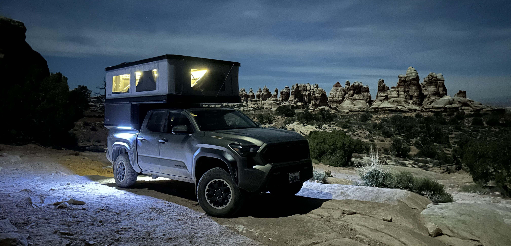
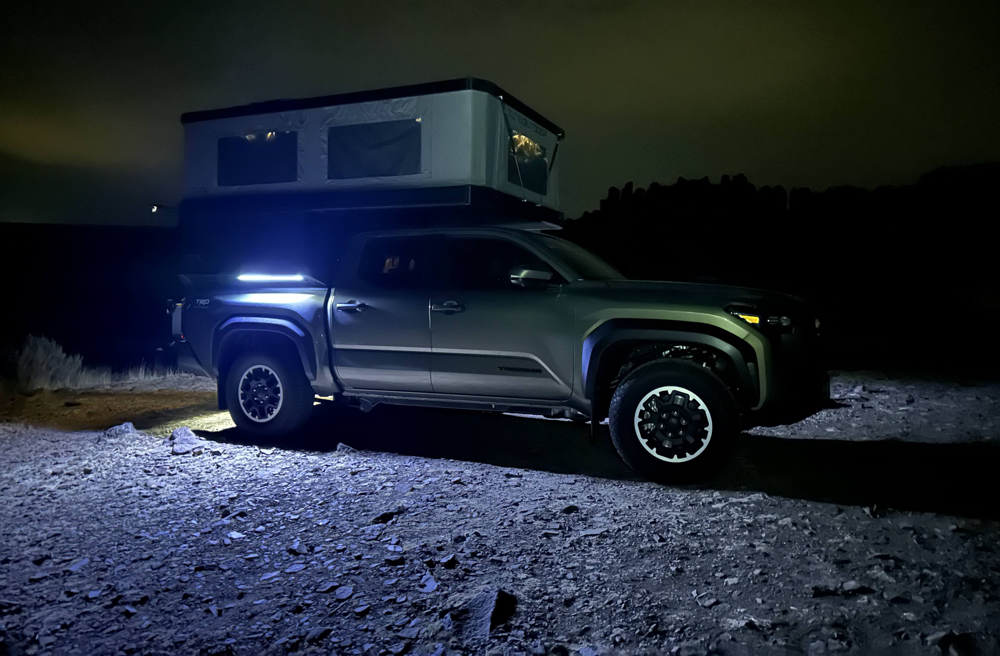
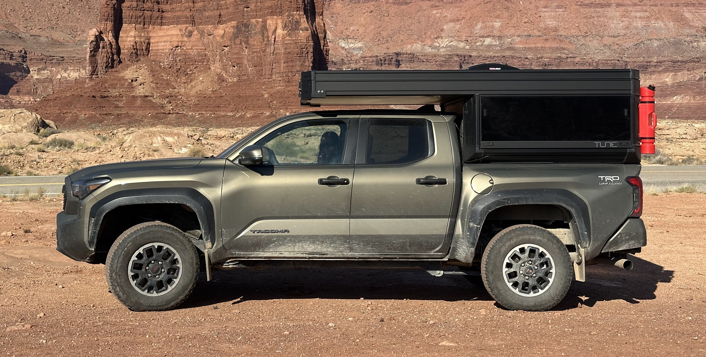

# Exterior side lights

I highly recommend installing some LED strips on the lower outside extrusions of the Tune! It makes walking around the truck in the dark way easier!

You can **make the lights automatically turn on** by wiring the lights to your truck's exterior truck bed lights. The Tacoma's truck bed light is in the stock third brake light, so I tapped a wire into that to power these lights, so that when I open my doors, these lights automatically come on! And when I close all the doors, they automatically turn off!

I simply bought the **[GUOTONG 16.4 ft White Waterproof LED Strip Lights](https://www.amazon.com/dp/B075LB9HK2)**, cut them to size (about 2 ft each), and direct wired them up to the rear third brake light's white light (you'll need experience soldering). They include adhesive tape, so it just sticks on right within the t-track of the Tune, and looks pretty sleek! 2 ft on each side illumates quite well!

And here's what it looks like in the daylight. Notice the black power cable running up towards the center.

