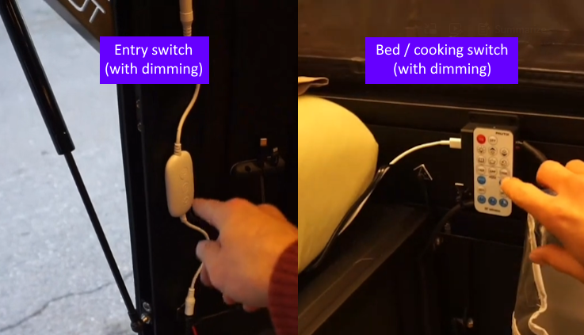

# Remote light switch

Do you wish you could turn your Tune's interior lights off from bed? While also having the switch at the entrance too? Here's how you can...

* Have a permanent mounted light switch at the entrance
* Have a remote you keep near the bed
* Be able to turn on/off AND dim the lights from either location!

It's really simple! [Just buy this Remote Dimmer Switch + Remote](https://www.amazon.com/gp/product/B091FK47KJ), and simply unplug the factory switch, and plug in the new one! Requires no special tools!

Dimming the lights from the physically mounted switch involves pressing a button multiple times, rather than a dial. It has about 10 brightness levels, so after pressing it that many times, it cycles back to the brightest setting.

Dimming the lights from the remote is even easier, since it has up/down buttons, and it even has three presets, "reading" (bright), "eating" (medium), and "night" (dim). We put some velcro on the remote and we keep it up near the bed and stove, so we can easily change the lights while cooking or while in bed.

See it in action below!

<iframe width="560" height="315" src="https://www.youtube.com/embed/QG-EsBX9r8k?si=2NR-LWfcW_nX5GmJ" title="YouTube video player" frameborder="0" allow="accelerometer; autoplay; clipboard-write; encrypted-media; gyroscope; picture-in-picture; web-share" referrerpolicy="strict-origin-when-cross-origin" allowfullscreen></iframe>